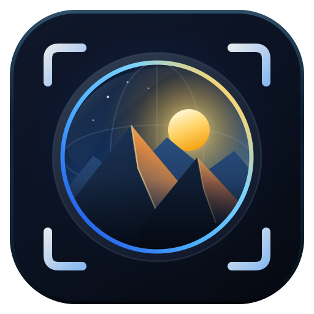

# PhotoEarth

A desktop 3D globe for photography location scouting: explore photorealistic terrain, read elevation, and simulate the sun for any date and time to see where light and shadow fall. See [SPEC.md](SPEC.md) for the full specification.

## Getting started

Requires Node.js 22.12+ (CI uses Node 24).

```bash
npm install
npm run dev        # electron-vite dev server with hot reload
npm run build      # production bundles in out/
npm start          # run the production build
npm run package    # Windows x64 NSIS installer in release/ (package:linux for an AppImage)
```

The Electron binary is downloaded on the first run.

### API keys

On first launch PhotoEarth asks for two keys, validates them with a test request, and shows which APIs are enabled:

| Key | Used for | Where |
|---|---|---|
| Google Maps Platform API key | Photorealistic 3D Tiles, 2D satellite/terrain imagery (Map Tiles API), place search (Places API (New)) | [Cloud Console → Credentials](https://console.cloud.google.com/apis/credentials). Enable **Map Tiles API** and **Places API (New)**. |
| Cesium ion access token | Cesium World Terrain: Elevation mode, profiles, terrain shadow overlay | [ion.cesium.com/tokens](https://ion.cesium.com/tokens) |

Both work on their free tiers. Either can be skipped and added later in **Settings → API keys**.

- Keys are encrypted with Electron `safeStorage` (DPAPI on Windows) and never written in plaintext. If the OS has no keyring (for example Linux without libsecret), keys are kept for the session only.
- Tile requests necessarily carry the Google key, so **restrict the key by API** (Map Tiles + Places). If you restrict it by HTTP referrer instead, allow `https://photoearth.local/*`: the app sends that fixed `Referer` on all Google requests.

## Using it

| | |
|---|---|
| Left-drag | Pan (grab the ground) |
| Right-drag / Ctrl+Left-drag | Orbit around the point under the cursor |
| Middle-drag / Shift+Left-drag | Rotate heading around the point under the cursor |
| Scroll / pinch | Zoom toward the cursor |
| Double-click | Fly closer to the point |
| Click | Inspect a point (coordinates and elevation, copyable) |
| `W A S D`, `Q`/`E`, arrows | Move (ground-relative), descend/ascend, look. Hold `Shift` for faster, `Alt` for precise |
| `F` | First-person fly mode (pointer lock; `Esc` exits) |
| `G` | Eye level (1.7 m) at the cursor; WASD then walks along the ground |
| `N` / `U` / `R` | Face north / top-down / level horizon |
| `1` / `2` | Photorealistic / Elevation mode |
| `Ctrl+K` | Search places, paste coordinates (decimal, DMS, Google Maps URLs), bookmarks, commands |
| `Ctrl+B` | Save a bookmark |
| `T` / `L` / `P` | Time & sun panel / elevation styling / elevation profile |
| `Space`, `[` `]`, `Shift+[` `]` | Play/pause the sun, ±15 min, ±1 day |
| `?` | All shortcuts |

## Development

```bash
npm run lint
npm run typecheck   # main/preload, renderer, and tests
npm test            # Vitest unit tests
npm run test:e2e    # builds with VITE_PHOTOEARTH_TEST=1, then Playwright drives Electron
```

On Linux the E2E suite needs a display (`xvfb-run -a npm run test:e2e`). Test builds expose the engine and a few Cesium classes on `window` for assertions; normal builds don't.

The sun-position tests compare SunCalc against [astronomy-engine](https://github.com/cosinekitty/astronomy) (VSOP87-based, sub-arcminute) as an independent reference. They cover nine locations, including Tromsø, Longyearbyen and McMurdo for polar day and night, and require ±0.5° (§8.4). Observed agreement is within 0.1° above 2° altitude. Tests run under `TZ=Pacific/Chatham` to prove results depend only on the viewed location's zone.

## Architecture

```
src/
  main/        Electron main: window, app:// protocol, CSP, Referer, permissions,
               settings.json / bookmarks.json / secrets.json, Places + key validation over net.fetch
  preload/     contextBridge → typed window.photoearth API
  shared/      types, settings defaults + sanitization, IPC channels, API error classification
  renderer/src/
    engine/    Engine (owns the CesiumWidget) and the managers from SPEC §4:
               TilesetManager, TerrainManager, GoogleImagery, CameraController,
               SunController, ElevationStyler, ProfileTool, PointInspector, Readouts,
               TerrainShadowOverlay, quality presets
    components/ React overlay UI (the canvas belongs to Cesium)
    store/     Zustand app state; React writes it, the engine subscribes to it
    lib/       pure, unit-tested logic: time zones, sun, seasons, coordinates, geoid,
               profile math, terrain-shadow ray marching, palettes, units
```

Notable decisions:

- **`app://photoearth/` protocol** instead of `file://`, so Cesium's module workers and wasm load from a real origin, and the strict CSP (no `unsafe-eval`) has a `'self'`. The window runs with `contextIsolation`, `sandbox`, `nodeIntegration: false`; navigation and new windows are blocked (external links open in the browser).
- **Places API calls and key validation run in the main process.** One autocomplete session token covers a whole search. Input is debounced at 250 ms with a 3-character minimum, and the field masks request only location fields.
- **Heights are shown above mean sea level.** Google tiles and Cesium terrain report ellipsoidal heights; readouts, profiles and contours are corrected with the EGM96 geoid (loaded lazily).
- **One custom globe material** composites hypsometric tint, slope classes, hillshade and contours (every 5th an index line). Hillshade follows the simulated sun (fading to flat shading at night) or uses the classic NW 45° light. It corrects for vertical exaggeration.
- **Local time follows the camera target.** The time slider is wall-clock time in the target's IANA zone, resolved offline. Crossing into another zone keeps the local time, so "07:30" means 07:30 wherever you look.
- **Google 2D Tiles** use the session-token flow, with renewal before expiry and on repeated 4xx tile failures. Attribution comes from the viewport endpoint for what's on screen. The 3D tileset shows its copyright data on screen.
- **Quality presets** set tileset/terrain screen-space error, shadow map size and cascades, soft shadows, shadow distance, MSAA/FXAA and resolution scale. Each value can be overridden in Settings. The scene uses request-render mode, so idle views cost nothing.

## M4 shadow spike (§8.1.1)

Real-time shadow maps can miss off-screen or distant casters. Both approaches ship so the spike can compare them directly:

1. Pick a valley with a reference photo of known date, time and place. Bookmark the view with **Include simulated date & time** on.
2. Photorealistic mode: compare Cesium shadow maps on the 3D tiles with the photo at low sun angles. Try the Ultra preset (8192 px, 30 km shadow distance) and rotate so the casting ridge is behind the camera.
3. Enable **Terrain shadow overlay** in the time panel (needs the ion token). It ray-marches Cesium World Terrain toward the sun on a fine grid around the view (~40–80 m cells) plus a coarse grid reaching 25 km further out, including earth curvature and refraction. It doesn't depend on what the camera has loaded.
4. Record which one matches the photo. If shadow maps are good enough, the overlay can stay an opt-in.

## Known limitations

- Visual behavior with live Google and Cesium data, the 60 fps target, and the shadow spike must be checked on Windows with real keys. The automated suite runs without keys.
- The terrain shadow overlay computes on the main thread, so scrubbing time while it's on can stutter.
- Google Maps short links (`maps.app.goo.gl`) can't be resolved offline; paste the full URL.
- macOS isn't a target. Linux is best effort.

## Attribution & terms

Google imagery and 3D geometry can't be exported, cached beyond the standard HTTP cache, or bulk-downloaded. Google, Cesium ion and imagery attributions are always shown in the status bar.
